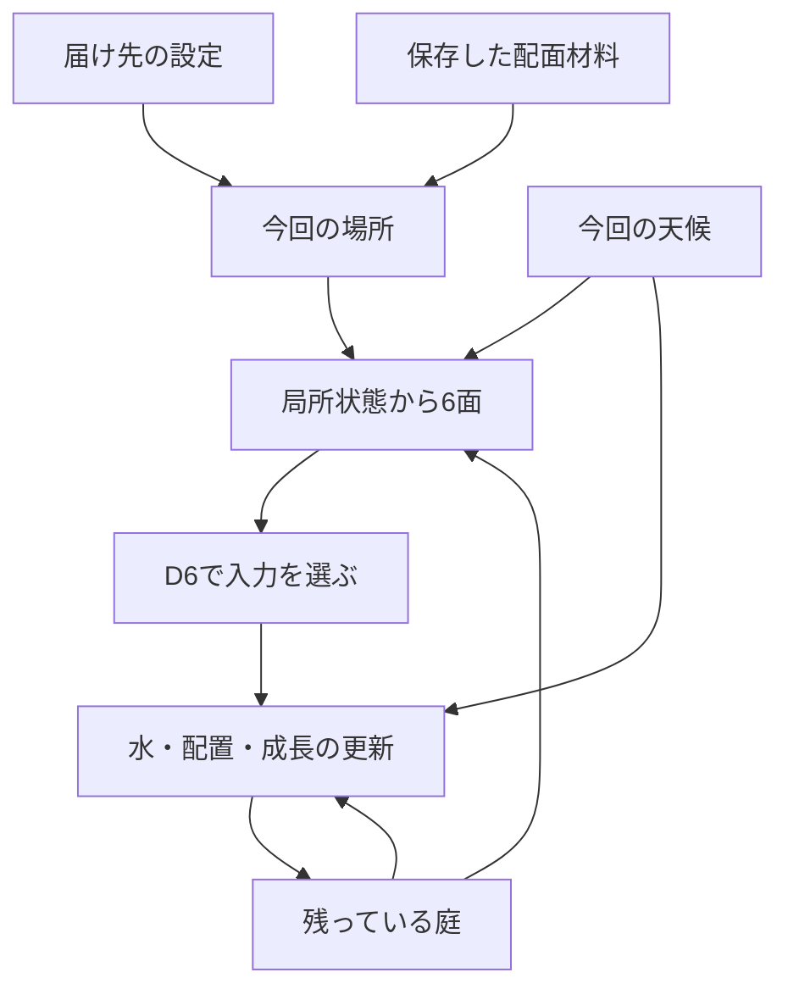

# それぞれの庭が育つ仕組み

設計版 **0.7 / designCandidate / 2026-11-12**。Unity実装・実機での見分けやすさは未検証。プレイヤーごとの多様性を、作用する場所と庭の履歴へ接続する。

現行の採用範囲は[CURRENT_DESIGN.md](./CURRENT_DESIGN.md)を入口にする。三地点・数値の参照・出生時の外観はv0.6を維持し、v0.7では選択時点の説明と表示確認の対応を整える。

## 1. 多様性を何で作るか

**同じ出目でも、届ける場所、そこに残っている水や植物、それまでの順番によって、違う育ち方が生まれる。** 何も設定しなくても場所が巡り、気になる場所があれば、そこへ働きかけ続けられる。

v0.5までは四つの作用anchorが固定され、種の届く土は20セルだった。意図は記録項目であり、自然計算に入らないため、プレイヤーの明示的な選択が庭の形へ残る経路が少なかった。v0.6では一つの地形と8入力を使い続け、次の二つを加える。

| 仕組み | 庭に残る違い | プレイヤーの必須操作 |
|---|---|---|
| 三つの届け先。既定は「おまかせ」、任意で一か所を持続指定 | 注水点、光と風の届く範囲、種の配置、次の局所needと配面 | 追加なし。変えたいときだけ選択 |
| 種を置いた時の土と空を使う花の外観 | 同じflower段階でも、出生時の条件に対応する色と花弁幅が残る | 追加なし。保存した根拠から自動表示 |

天候、配面、D6、カード、土の水分、植物の成長は既存の仕組みを使う。場所と過去の状態が組み合わさるため、選択を続ける人、途中で変える人、おまかせで眺める人に、異なる配置と経過が生まれる。これは性格診断や本人の特性を推定する機能ではない。

有限のセルと成長上限があるため、全員に永久に異なる完成図を保証しない。「無数のパターン」は、固定した何本かのシナリオを再生するのではなく、多くの選択・偶然・蓄積から展開を作るという制作目標とする。runIdの違いや乱数seedの桁数を、そのまま見た目の種類数へ数えない。

## 2. 三つの届け先

正となる候補値は[target-profile.v0.6.json](./content/target-profile.v0.6.json)。地形、岩、排出口、土容量、初期植物は既存mapのまま使う。

| siteId | 表示名 | 中心 | この場所で観察する関係 |
|---|---|---|---|
| `inlet` | 入口 | cell85 `(5,5)` | 浅い受け皿、乾いた近傍、先へ流れる水 |
| `shade` | 岩陰 | cell135 `(7,8)` | 岩による光・風の違い、既存つぼみと空き土 |
| `meadow` | ひらけた土 | cell154 `(10,9)` | 過湿な土、比較的開けた場所、種を置く位置の違い |

その回は水・風・光・種の四anchorを、選ばれた場所の中心へまとめる。8入力の総量・半径・時間・東向きの風、土・水・成長の数式は変えない。場所ごとに特別な成長倍率や隠れた能力は付けない。

種の範囲は中心から距離0〜1／2〜3、実配置は空き土の距離・cellId順を維持する。同じ場所でも、先に置いた種が次の候補を変える。ある場所の種範囲が埋まっても、別の場所には空き土があり得る。場所が重なるセルでは同じ一個体を共有し、地域ごとの別植物として複製しない。

三地点の範囲の和集合と配置上限は[GARDEN_LAYOUT.md](./GARDEN_LAYOUT.md)§7で確認する。旧固定anchorでの21個体上限を、新しい方式の上限へ流用しない。

どの場所でも水・風・光の三系統は定義できるように検証する。種が置けない場所が選ばれたとき、他の場所へ自動的に変更したり、種だけ範囲外へ逃がしたりしない。現在の範囲で種が候補外になった理由を、任意の説明で伝える。

### おまかせで始められる

新runの設定は`mode=auto / siteId=null`。配面用の保存材料から三地点を等確率で選び、その場所を使って局所needと6面を作る。自動選択にも同じ場所の連続を認める。新鮮さを演出するための引き直しや、前の開花を見た後の場所補正はしない。

手動では`mode=fixed`とsiteIdを選ぶ。公開中の一投は保持し、その一投の後に準備する回から指定を使い、以後も持続する。「おまかせ」へ戻すこともできる。細かい照準、マス選択、毎回の決定操作は設けない。庭や植物の詳細を開く操作は、届け先の変更を兼ねない。

### 場所と配面を一緒に固定する

`dynamic-faces.v0.6`では、保存したmapping bufferの先頭で`UniformBelow(3)`を一度呼び、`inlet / shade / meadow`の順からdrawnSiteIdを得る。fixedでも同じ呼出しを行い、消費量と棄却数を残す。fixedの実際の場所は保存済みの指定、autoはdrawnSiteIdとする。その後、残りのbufferから既存の系統・recipe選択とshuffleを行う。

この順序により、場所が先に決まり、その場所の実状態から配面重みが生まれる。位置抽選は配面生成の一部であり、配面と統計的に独立した抽選とは呼ばない。天候・D6・カードとは別roleの材料を使う。祈り、自由文、カード、的中率、待った時間はこの計算へ入力しない。

図の循環は次の投擲への持越しを表す。同じ一投の計算中に、結果を見て配面や場所を選び直す処理はない。正確な保存順とDTOは[DATA_CONTRACT.md](./DATA_CONTRACT.md)、配面式は[GAMEPLAY.md](./GAMEPLAY.md)を正とする。

## 3. 今回と次回を取り違えない

公開した6面には作用先も含まれている。Readyで場所を選んでも、**これから振る公開中の一投は、その場所と6面を保つ。その一投が終わった後に準備する回から、選んだ設定を使う。** 提示中の選択は、その提示を終えてから始まる準備へ使う。

| 画面の状態 | 場所の操作 | 何へ反映するか |
|---|---|---|
| Ready | 任意の変更を受け付ける | 次のPreparationStarted。今回のPreparedは不変 |
| Holding / 取得・解決中 | 場所の変更を受け付けない | 押下前に確定した今回の条件を保つ |
| Presenting | 任意の変更を受け付ける | 今回の結果を表示し終えた後の準備 |
| Preparing | 場所の操作を無効にし、クリックを予約しない | 開始時に固定した設定を使う |

表示は常に「今回：岩陰」のように確定した場所を示す。予約が違うときだけ「次から：入口」などを添える。次回autoはまだ地点が決まっていないため「次から：おまかせ」とし、未抽選の地点を先取りしない。fixedで今回と同じ場所を選んだ場合も、autoからfixedへ設定が変わったことは小さな設定表示で確認できるようにする。

v0.6では演出中の次回PreparationStartedを先行実行しない。結果再生の終了・省略後、保存済みの終状態を表示し、それ以前に受け付けた場所変更をwriterで処理してから次の準備へ進む。これにより、次の投擲への指定が非公開の先行準備に追い越されない。新しい確認ボタンや待機タイマーは作らない。

場所を変えた操作のreleaseで振らない。保存に失敗した場所指定を反映済みと表示せず、同じcommandを再試行する。再起動後は保存済み設定を復元し、作成済みPreparedがあればそちらの場所を今回として表示する。取消・中断の厳密な競合はDATA_CONTRACTに従う。

## 4. 花に残す、種を置いた時の色と形

これは**表示だけの規則**であり、植物の種類や生命力の差は作らない。[plant-appearance-profile.v0.6.json](./content/plant-appearance-profile.v0.6.json)をrunへ固定し、`birth-appearance.v0.6`で読み取りprojectionを作る。水、成長、配面重み、当たり外れ、文章選定は外観を参照しない。

### 色は、同じ個体の播種時の土から

| 保存済みSeedPlaced.soilQAtPlacement | paletteId | 色の制作候補 |
|---|---|---|
| 0〜399 | `ivory` | あたたかい白 |
| 400〜700 | `rose` | 淡い桃色 |
| 701〜1000 | `lilac` | 淡い藤色 |

これはゲームの表現規則であり、現実の花色を土の水分から予測するモデルではない。paletteの分類境界はこのprofileの固定値とし、別のprofileの適湿値を後から参照して勝手に分類を変えない。

### 花弁幅は、同じ播種回の空から

| 播種した回の保存済みWeatherContext | petalWidthQ | 基準の花弁幅に対する倍率 |
|---|---:|---:|
| clear | 1000 | 1.00 |
| cloudy | 900 | 0.90 |
| drizzle | 1100 | 1.10 |

三つの色と三つの幅で、最大9組の見た目の組合せを定義する。一つの植物モデルを使い、花の部分だけに色と幅を適用する。茎や根の位置、当たり判定、土容量、影のCoreデータは変えない。花は保存されたflower段階でのみ見せる。まだ種・芽・つぼみの個体を、色を見せるために開花扱いにしない。

値は美術の初期案であり、9組が実プレイで必ず発生すること、全てを画面で見分けられることは未確認。G3で端末・照明・低刺激設定の見え方を確認する。色だけへ情報を依存させず、植物の詳細には実際の播種時の土と天候を文字でも出せる。

### 根拠と固定のしかた

1. `originKind=seedInput`の同じplantId/cellIdについて、seedSourceRoundIdが指す保存済みSeedPlacedを取得する。別個体や現在の水分で代用しない。
2. `soilQAtPlacement`は実際に種を置いたtickの値を使う。そのtickの吸水・蒸発より前なので、今から降る雨を既に土が吸った水へ加算しない。
3. 同じroundのPrepared.weatherContextと、保存したstyle profileからpaletteId/petalWidthQを決める。枠内の値をさらに乱数で変えない。
4. projectionにはplantId・birthRoundId・出生Resolvedの`{seq,entryHash}`とeventId・出生Preparedの`{seq,entryHash}`とweatherContext.weatherSourceRef・style content hash・appearanceProjectionVersionを持たせ、表示cacheはそこから再構成できるようにする。WeatherContextへ存在しないsourceRefフィールドを追加した扱いにせず、保存recordの参照を使う。cacheを新しい自然状態や追記イベントの正としない。
5. 以降の天候や届け先が変わっても、当該個体の基準外観は変わらない。現在の照明による見え方の変化と、保存した基準色は区別する。

初期mapの四個体は共通の`ivory / 1000`を使い、sourceKind=initialMapとする。存在しない播種回や過去の天候を作らない。seedInputの証拠が欠けた場合はunknown表示と中立のplaceholderへ落とし、初期個体だったと読み替えない。書き出しには既存の出生recordとstyle profile原本を含める。

この小さな見た目の追加はG3で扱う。展示までに余裕がない場合、まず場所による実際の分岐を完成させ、外観を中立表示にしたビルドはその範囲を明記する。表示品質設定によって生態計算の意味は変わらない。

## 5. 履歴とオラクルへのつながり

「庭の歩み」にはその回の確定場所を添える。自分で指定したか、おまかせだったかも保存参照から分かる。これからの予約を、過去の投擲の場所として描かない。

関係図では「場所の設定 → 確定した作用範囲 → 実際の入力 → 局所状態・出来事」をモデル上の依存として示せる。一方、意図・方法・願いの本文は従来どおり事前記録の対応として扱う。外観の関係は「出生記録 → 表示規則 → 花の外観」と明示し、外観から成長や運勢への因果を作らない。

28本の本文を維持し、新runではcatalog v0.7と`oracle-focus.v0.7`を使う。選ぶ順位はv0.5を継承し、日陰のつぼみに光が届いた文は同じ焦点セルのダイス追加光の証拠を必要とする。同じ言葉でも、指している植物・場所・時点が違えば、庭の実際の文脈が変わる。文章を増やすために未発生の変化を作らない。選択場所の外で成長した個体も、実際の根拠から主焦点になれる。選んだ場所へ常にカメラや音を合わせるのではなく、保存されたPresentationPlanに従う。

## 6. 多様性を確かめる条件

同じ出目番号でも配面が違えば別のrecipeになる。そこで、「同じrecipeで場所だけ変える比較」と「同じ乱数材料でプレイ方針を変える比較」を分ける。

| 比較 | そろえるもの | 見る違い |
|---|---|---|
| 作用場所だけを変える | 初期庭、天候、recipe、40tick | 実入力セル、吸水・蒸発、植物配置と成長 |
| 入力の順を変える | 初期庭、場所、入力の種類と回数、総tick | 種の存在時刻と、その後の成長 |
| プレイ方針を変える | 初期庭、seed番号、天候・mapping・D6・カード材料列 | 各場所の履歴、配面、庭の経過 |
| 同じ条件を再実行する | 初期庭、場所設定列、全材料、全版 | 数値・対象・結果の一致。再現性を多様性と両立 |

固定集合はseed0〜15、各24投、auto・inlet固定・shade固定・meadow固定・3投ごとに三地点を巡る方針。6・12・24投で全結果を残し、似た庭や成長0の回も除外しない。循環方針は試験用の操作列であり、通常のautoに隠れた巡回規則を加えない。

比較はIDやrun名を外した正確な物理状態と、植物の占有セル・成長段階・土の湿り帯・水たまりの閾値に達したセルなどの粗い空間状態を分ける。地表水は終了時の水深120以上のセル集合を使い、薄い水の有無や途中のPuddleFormed発生とは区別する。原本の数値と粗い分類の境界はreportに残す。花の色、カード、メッセージだけの違いを物理状態の種類数へ加算しない。

G2の設計用目標として、auto16列の24投時点で粗い物理状態が8種類以上、三つの固定場所が互いに異なる粗い状態を作るseedが12投・24投のそれぞれで8件以上、と先に置く。集合や閾値を結果を見て変えず、不達の場合はそのまま報告して設計を見直す。この小集合の達成は、全プレイヤーの固有性・Unity画面の美しさ・長期の飽きにくさの証明ではない。

実行した参照の範囲・結果・実装後の残りは[VALIDATION.md](./VALIDATION.md)と[diversity-reference-report.v0.6.json](./content/diversity-reference-report.v0.6.json)を参照する。保存競合、花のprojectionと端末上の表示は、自然の整数参照と別に確認する。

画面で比べる開発fixtureは[EXPERIENCE.md](./EXPERIENCE.md)§9.2の三つへ固定する。V1は晴れのひと粒の種を三地点へ置く単発比較、V2はseed0・同材料・三地点固定方針の12投目、V3はひらけた土で種と光の順番を逆にした80tickの比較。V3のcell138は成長107／73でも両方seedで、粗い物理状態は同じになる。違う庭を見分けることと、細かな数値差を発芽や別の外観へ誇張しないことを一緒に確かめる。これは表示確認用の選定であり、元の16seed・全80列の結果集合や多様性の判定を変更しない。

## 7. 版と実装範囲

| 部分 | v0.7で採用する候補 |
|---|---|
| 地形・初期状態 | garden-map.v0.3。自動生成地形・新しい初期乱数なし |
| 水・土・成長 | simulation-profile.v0.2 + weather-profile.v0.4の既存整数式 |
| 場所・配面 | target-sites.v0.6 / dynamic-faces.v0.6 |
| 天候・group生成 | weather-episodes.v0.4 / observation-groups.v0.4 |
| 文章 | 28文catalog v0.7 / oracle-focus.v0.7。順位はv0.5を継承 |
| 花の基準外観 | plant-appearance-profile.v0.6 / birth-appearance.v0.6 |

G1で場所設定の保存と準備境界、G2で三地点の展開と自然計算、G3で表示・履歴・外観を接続する。三地点を扱うために複数Scene、地形エディター、植物の遺伝、動物AI、季節の生死、実行時生成AIは追加しない。成熟後も水・風・光・天候を観察でき、花や履歴を自動で消さない。

旧runは採用済みのmap・anchor・配面・文章・表示規則を使い、v0.7の文章条件も新runにだけ適用する。v0.6の場所抽選を旧mapping bufferの先頭へ後付けせず、過去の結果を再生成しない。展示の次の来場者は新run・既定autoから始め、前の人の意図や場所指定を引き継がない。
