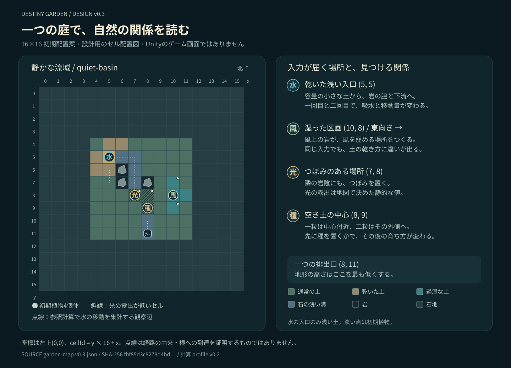

# 初期庭「静かな流域」— 配置 v0.3・場所による分岐 v0.6・連続注水 v0.7

**状態：G0の設計候補。Unity未実装。** 16×16の庭を具体的なセルデータへ落とし込み、既存v0.2の整数式で全庭を参照計算した。展示の見やすさ、スマートフォンの処理速度、Unityと参照計算の一致は、これから確認する。

正となる配置は [garden-map.v0.3.json](./content/garden-map.v0.3.json)、v0.3作成時に実行した入力と結果は [garden-reference-report.v0.3.json](./content/garden-reference-report.v0.3.json)。当時の計算式と8レシピの量・時間・範囲は [simulation-profile.v0.2.json](./content/simulation-profile.v0.2.json) を用いた。現行の式の正は [SIMULATION.md](./SIMULATION.md)。profileの「展示地図は未実データ化」という記述はv0.2作成時点の状態であり、§1〜5はv0.3の配置と参照結果、§6はv0.5で追加した静的確認と実装後の境界条件として読む。



図はauthoring JSONのセル配置を示す。Unity画面、完成時の美術、実際の水の追跡画像ではない。

v0.4ではこの静的な配置・初期水分・植物を再利用し、[WEATHER.md](./WEATHER.md)の三天候を加える。本書の比較数値と全16列は、v0.3の基礎光500・基礎風0による参照結果として保持する。新しい天候込みの数値は[weather-reference-report.v0.4.json](./content/weather-reference-report.v0.4.json)へ分けて残す。

v0.5では地図・係数を変更せず、§6へ種が届く範囲の上限、花が残る庭の受け入れ状態、湿りを描く量を追加する。種範囲の列挙と保存済みv0.4列の照合は静的に確認した。§6.2の成熟庭18ケースは今後の受け入れ条件であり、今回の実行済み参照数へ加えない。

v0.6は同じ地形・初期水分・初期4個体を使い、**入口・岩陰・ひらけた土という3地点のどこへ届けるか**を追加する。現行の作用先と参照比較は§7を正とする。§1〜6の4つの固定anchor、21個体の上限、旧参照列と成熟庭18ケースは、v0.3〜v0.5の履歴資料として保持する。旧mapのanchor値や旧runの記録をv0.6の選択地点へ書き換えない。

v0.7は地形と自然の係数を変えず、§8で三地点それぞれへ小雨と最大注水を重ねた参照を追加する。旧入口での連続入力を、岩陰・ひらけた土への連続入力まで確認済みだったと読み替えない。現行候補の組合せは[CURRENT_DESIGN.md](./CURRENT_DESIGN.md)を入口にする。

## 1. 一つの小庭で見せる三つの関係

庭は排出口へ向かう緩い窪地とし、中央の8×8区画に土、三つの岩、石の流路、四つの初期植物を置く。周囲は水を通す石の地面。水・風・光・種の新しい種類や新しい物理処理を増やさず、配置と土の容量の違いで変化を作る。

| 見せる関係 | 配置と働き | 体験で読むもの |
|---|---|---|
| 水と受け皿 | 左上の浅い入口、近くの乾いた土と湿った土、岩の東側を回る石の流路、下方の排出口 | 最初に吸う場所と、その後に吸う場所の違い |
| 風と岩陰 | 右側に同じ湿り・同じ光・風中心から同じ距離の二地点 | 風が通る場所と弱まる場所の乾き方の違い |
| 光と種の時間 | 光中心のつぼみ、岩陰のつぼみ、中心と外側に分かれた空き土 | 同じ入力でも、既にある植物・置かれた種・場所によって成長が変わること |

各投擲では**庭全体が40tick進む**。選ばれた入力の範囲外でも、土の蒸発と基礎光による植物の成長が起きる。入力の局所効果と、この共通の時間経過を記録・メッセージ・演出で混同しない。

## 2. セルと初期状態を確定する

### 座標と高さ

左上を `(0,0)`、右を+x、下を+y、`cellId = y * 16 + x` とする。JSONの `heightRows[y][x]` が高さの正で、今回の値は `60 * (abs(x-8) + abs(y-11))` で作成した。最も低い `(8,11)` に唯一の排出口を置く。

高さ・水深は面積1のモデル単位。メートルやリットルへの換算はしない。外周の格子外への辺は閉じ、排出は指定セルの出口規則だけで処理する。地形上の接続と、一定時間内の十分な排水は別々に確認する。

| 地形記号 | 内容 | 土の容量 | 吸水/tick | 初期土中水 | 植栽 |
|---|---|---:|---:|---:|---|
| `.` | 周囲の石の地面。非solid | 0 | 0 | 0 | 不可 |
| `m` | 通常の土 | 1000 | 20 | 550 | 可 |
| `d` | 乾いた受け皿 | 1000 | 20 | 80 | 可 |
| `s` | 入口の浅い土、一セルだけ | 200 | 20 | 10 | 可 |
| `w` | 風を見る過湿な土 | 1000 | 20 | 950 | 可 |
| `c` | 流路を見せる石の地面。非solid | 0 | 0 | 0 | 不可 |
| `#` | 水と風を遮る岩。solid | 0 | 0 | 0 | 不可 |

`cellOverrides` で光の露出や少数地点の初期水分を上書きする。非solidは253セル、植えられる土は55セル、初期の地表水は全セル0、土中水の合計は28,960。周囲の石をsolidな壁へ読み替えると、風上rayが別の岩に遮られるため、同じ庭として扱えない。

### 入力位置と主な観察地点

| 役割 | 座標 | cellId | 初期の意味 |
|---|---|---:|---|
| 水入口 `waterInlet` | `(5,5)` | 85 | 容量200、水10。水分比50/1000の浅い乾いた土 |
| 近くの湿った土 | `(5,7)` | 117 | 容量1000、水850 |
| 風中心 `windCenter` | `(10,8)` | 138 | 東向きの風。初期水950 |
| 風陰の観察点 | `(10,7)` | 122 | 西の岩 `(8,7)` が最初の遮蔽物 |
| 風が通る観察点 | `(10,9)` | 154 | 西向きに探索しても岩がない |
| 光中心 `lightCenter` | `(7,8)` | 135 | 露出600。根拠となる岩は `(6,7)` |
| 光の岩陰 | `(8,8)` | 136 | 露出200。根拠となる岩は `(8,7)` |
| 種中心 `seedCenter` | `(8,9)` | 152 | 露出800、水600。最初の一粒の着地点 |
| 外側の適湿な土 | `(9,8)` | 137 | 水550。最初の二粒のうち一粒が着地 |
| 外側の乾き気味の土 | `(6,9)` | 150 | 水200。最初の二粒のうちもう一粒が着地 |
| 唯一の排出口 | `(8,11)` | 184 | 土なし。堰高は地形高+150、排出上限100/tick |

光の遮蔽は固定の露出値と `lightOccluderCellId` による設計値。GPUの影画像や動的な太陽のray計算はCoreに導入しない。見た目の岩陰は、この固定データと合うように制作する。

初期植物は次の四つだけ。初期状態からある個体なので `originKind=initialMap` とし、架空の播種記録を作らない。

| plantId | cellId | 初期growth | 段階 |
|---|---:|---:|---|
| `initial-light-bud` | 135 | 1700 | bud |
| `initial-shadow-bud` | 136 | 1700 | bud |
| `initial-wind-sheltered` | 122 | 500 | sprout |
| `initial-wind-exposed` | 154 | 500 | sprout |

### JSONの展開と同一性

展開順は `terrainRows` の記号から `cellTypes` を取得 → `heightRows` → `stateDefaults` → `cellOverrides` → `initialPlants`。初回の `meanLight` は基礎光と各セルの露出から整数式で求める。JSON中の式名は展開契約の説明であり、任意の文字列を実行する仕組みではない。

`expandedCellsEncoding.columns` の順で256セルの整数/null行列を作り、空白・末尾改行のないUTF-8 JSONをSHA-256へ渡す。これは初期セル値の照合用で、植物を含む完成した `WorldSnapshot.stateHash` とは異なる。reportには配置JSONのファイルhash、展開セルhash、使用profileのファイルhashも保存した。

## 3. 八つの入力が最初から働く

初期状態では8レシピすべてに有効な対象がある。以下の範囲は投擲前に解決して保存する。種の候補は空きセルが減ると変わり、必要な空き数を満たさないrecipeは配面候補から外れる。

| レシピ | 初期対象 | 最初の40tickで参照計算した違い |
|---|---|---|
| `water_drop` | 85へ一度に1200 | 入口が160吸水。光中心の土が35吸水 |
| `water_rain` | 69, 84, 85, 86, 101へ計1200を12回分割 | 入口が190吸水。光中心の土が40吸水 |
| `wind_breeze` | 中心から距離3以内の非solid 24セル | 風陰の土950→916、露出した土950→870 |
| `wind_passage` | 122, 137, 138, 139, 154 | 風陰の土950→910、露出した土950→850 |
| `light_soft` | 距離2以内の非solid 11セル | 光中心のgrowth 1700→2150、岩陰1700→1833 |
| `light_beam` | 135だけ | 光中心1700→2300。範囲外の岩陰も基礎光で1700→1800 |
| `seed_single` | 152へ一粒 | tick25で発芽。40tick後のgrowthは400 |
| `seed_scatter` | 137と150へ一粒ずつ | 適湿な137はgrowth500、乾き気味の150は149 |

吸水は地表から土への累計移動で、最終的な土中水の増分とは異なる。たとえば一滴目の光中心は35吸い、その投擲中に12蒸発するため、土中水は550→573になる。

### 水：受け皿が変わると、次の反応も変わる

初期状態から `water_drop → water_drop → light_beam` を順に適用した。

| 観察値 | 一滴目 | 二滴目 |
|---|---:|---:|
| 入口の累計吸水 | 160 | 47 |
| 入口の土中水、投擲後 | 153 | 185 |
| 光中心の累計吸水 | 35 | 39 |
| 光中心の土中水、投擲後 | 573 | 600 |
| 全庭の辺を通った累計移動量 | 2138 | 2384 |
| 次の配面で使う `water_drop` の重み | 100 | 100 |
| 次の配面で使う `water_rain` の重み | 178 | 129 |

入口は浅いため、二滴目には空き容量が減る。実際の局所差を得るために、最初の草案から変えたのは入口一セルの容量1000→200、初期水80→10だけ。profileの量・式、抽選用seed集合は変更していない。初稿では光中心の吸水が一滴目35・二滴目35だった。

初期の配面重みは一滴275、雨264。入口の湿りが変わると一滴の重みは100になり、周りの乾いた土にも届く雨とは重みが分かれる。次の出目を決めたり、開花へ誘導したりする規則は追加しない。

岩の東側の観察辺でも実際の正の移動を得た。一滴目の `85→86→87→103→119→135` の各辺の累計は272, 208, 95, 41, 35。これらはそれぞれの辺を通った水の集計であり、特定の水粒子が端から端へ通った証明ではない。`verified_path_to_root` は成立扱いにしない。

三投目の光で光中心はgrowth2500に達し、全体tick94で開花した。既につぼみから始まり、先の二投でも基礎光によって成長している。「この光だけが開花を起こした」「水が必須だった」とは述べない。

### 風と光：位置の根拠を残す

風の比較点122と154は、容量1000・初期水950・基礎光500・中心からの距離1が同じ。`wind_passage` の実効風は岩陰125、露出側500で、土中水はそれぞれ910、850になった。成長は500→541と500→602。これにより、岩の遮蔽と実際の蒸発・成長の差を同じ庭で観察できる。

この一投では両地点とも水分比700を超えているため、メッセージ条件 `moisture_returned_to_band` は満たさない。「風で水分が減った」と「適湿へ戻った」を分ける。

光中心と岩陰の比較は、中心からの距離と静的露出の両方が関わる配置である。`light_soft` の実効光は450と133、`light_beam` の範囲外である岩陰には基礎光100が残る。入力外での成長も、実際の場所と値を根拠に記録する。

### 種と光：順番を入れ替えた同じ80tick

| 順番 | 種中心の最終growth | 最終土中水 | 記録される段階 |
|---|---:|---:|---|
| 一粒の種 → 柔らかい光 | 866 | 566 | tick25で発芽、tick71で葉 |
| 柔らかい光 → 一粒の種 | 400 | 566 | tick65で発芽 |

両方とも同じ初期状態から80tick進め、入力を一回ずつ使っている。先に種があれば二投とも成長し、二投目には実効光466を受ける。先に光を使った場合、まだない種へ過去の光を蓄積しない。光中心の既存つぼみは両順序でgrowth2450となる。

## 4. 全庭の水収支と、固定した十六列

参照はPython標準ライブラリの整数計算。各単発・順序比較・連続注水・seed列をそれぞれ初期状態から開始し、全セルを更新した。

| 今回実行した集合 | 投擲解決数 | tick数 |
|---|---:|---:|
| 8レシピを各一回 | 8 | 320 |
| 水2回→光、種→光、光→種 | 7 | 280 |
| 一滴を200回、雨を200回 | 400 | 16,000 |
| seed 0〜15を各24投 | 384 | 15,360 |
| 合計 | 799 | 31,960 |

全31,960tickで `水の増減 = 注入 − 地表蒸発 − 土中蒸発 − 排出` の残差0を確認し、地表水・土中水・成長・端数はprofileの範囲内だった。Pythonの任意精度整数による確認であり、C#のchecked Int64動作を実行した結果ではない。全イベント生成・オラクル文の選択・描画はこの参照に含まない。

### 連続最大注水

| 指標 | 一滴×200 | 雨×200 |
|---|---:|---:|
| 総注水 | 240,000 | 240,000 |
| 最初の排出が起きた投擲 | 41 | 37 |
| 累計排出 | 35,082 | 40,116 |
| 最大セル地表水、注入直後を含む | 1,200 | 150 |
| 完了tick後の最大セル地表水 | 593 | 150 |
| 最終の全庭地表水 | 1,290 | 1,409 |
| 最終の全庭土中水 | 36,999 | 35,105 |

排出口までの非solid接続と、この200回の数値範囲を確認した。最初の数投は土が吸水し、蒸発も進むため、すぐには排出されない。無限に続けたときの安定性や、美術上許容できる水位は未判定。特に一滴の注入直後と、tick完了後の水位を表示でどうつなぐかはUnity側の確認事項になる。

### 補正していない設計参照列

seed集合は計算前に0〜15と固定し、全16列を掲載した。乱数材料は `source=fixture`。`mapping`・`outcome`・`oracle` を別roleとするSHA-256 counter列から生成し、配面256byte、出目32byte、カード32byteを用意した。配面は3系統を先に抽選しきる→その順で各recipe→残り3枠→Fisher–Yates。候補順と除外後の順、棄却法、入力文字列はreportへ記載した。

| seed | 最初の段階変化/投 | 最初の開花/投 | 24投後の植物/花 | 整数成長がなかった投数 |
|---:|---:|---:|---:|---:|
| 0 | 1 | 3 | 15 / 11 | 0 |
| 1 | 1 | 2 | 21 / 12 | 1 |
| 2 | 1 | 3 | 11 / 6 | 4 |
| 3 | 2 | 2 | 17 / 5 | 0 |
| 4 | 2 | 3 | 12 / 10 | 2 |
| 5 | 2 | 2 | 15 / 6 | 0 |
| 6 | 1 | 3 | 15 / 11 | 1 |
| 7 | 2 | 2 | 13 / 6 | 0 |
| 8 | 2 | 2 | 21 / 13 | 0 |
| 9 | 3 | 3 | 15 / 5 | 0 |
| 10 | 1 | 3 | 13 / 9 | 2 |
| 11 | 2 | 3 | 8 / 5 | 3 |
| 12 | 1 | 3 | 15 / 9 | 0 |
| 13 | 2 | 3 | 17 / 9 | 2 |
| 14 | 2 | 3 | 16 / 9 | 0 |
| 15 | 2 | 3 | 19 / 11 | 1 |

384配面すべてで3系統以上・同recipe最大2面・同系統最大3面を満たした。カード384枚分の面を独立に引いたが、自然文の選択処理は実行していない。短い24投の列では排出は全列0。384投のうち16投は全庭の整数成長増分が0であり、その場合でも水分などの状態変化がなくなるとは限らない。

**最初の開花が全16列で2〜3投だったことには、初期growth1700のつぼみと全庭の基礎成長が寄与している。** 祈りやカードが開花を保証した結果ではない。出目を変えて成功列を作っていない一方、この集合は配置の調整にも使った設計参照で、独立した検証標本ではない。実プレイの成功率や開花時刻へ一般化しない。

## 5. 実装へ渡す範囲と、残る確認

v0.3のこの候補が追加したのは地図データと参照値だけ。固定された四系統・八recipe、40tick、静的な影、既存の土容量と吸水式で表現する。初期植物を増やすランダム処理、目標に合わせた配置変更、入力後の対象の選び直しは加えない。

G2では同じ配置・入力からC#のセル値、端数、段階変化を比較する。参照reportの `finalStateNumericHash` は数値行列用で、個体IDや累計ledgerを含む正式な `WorldSnapshot.stateHash` ではない。JSONのまま通常プレイのjournalへ読み込まない。新しい植物のIDは [DATA_CONTRACT.md](./DATA_CONTRACT.md) と [SIMULATION.md](./SIMULATION.md) の規則へ従う。

手動確認はUnityで次の三つの場面に絞れるようにする。確認しやすい固定入力を開発用に呼び出し、通常プレイの配面・出目とは分ける。

1. **水の二投と下流**：入口で吸われる量の違い、岩を回る流れ、入口・根元・排出口の見え方が数値と矛盾しないか。
2. **風と静的な影**：二つの湿った土の差と、光中心・岩陰の差が、固定カメラのスマートフォン画面で読めるか。
3. **種と光の順序**：二つの80tick比較を同じ再生速度で見て、種・発芽・葉・基礎成長を過剰な発光や音で混同させていないか。

この三場面の視認性、連続200注水の表示、終了・復帰時の保存、端末性能はまだ実行していない。自動確認が担える数値の整合と、人が見る必要のある美しさ・読みやすさを、それぞれの結果として残す。

## 6. 育った庭で、観察を続けるための境界

### 6.1 種が届く土と、庭全体の土を区別する

v0.3〜v0.5の固定seedCenterはcell152。植栽可能な土を、その中心からのマンハッタン距離と既存recipeの帯で列挙すると、次の範囲になる。以下は現mapの静的な個数であり、通常プレイの出目頻度ではない。

| 範囲 | 対象cellId、数値昇順 | 土の数 | 初期占有 | 初期から追加できる個体 |
|---|---|---:|---:|---:|
| 一粒の種、距離0〜1 | 136, 151, 152, 153 | 4 | 136の1個体 | 3 |
| 二粒の種、距離2〜3 | 104, 121, 134, 135, 137, 138, 149, 150, 154, 155, 166, 167, 169, 170, 183, 185 | 16 | 135, 154の2個体 | 14 |
| 両方の合計 | 非重複の20セル | 20 | 3個体 | **17** |

追加する順序はこの表の掲載順ではなく、既存の「anchorからの距離昇順、同距離ならcellId昇順」に従う。範囲外にも35セルの植栽可能な土があり、そのうちcell122には初期個体がいる。両方の種範囲を使い切ると、全個体は初期4＋追加17＝**21個体**、空いたままの土は**34セル**となる。植栽可能であることだけでは、この版の固定anchorから種が届くことを意味しない。

既存v0.4 reportのseed=1では、一粒の種が4・6・15投目、二粒の種が1・2・3・7・13・14・20投目に選ばれた。15投目の後に一粒の候補が、20投目の後に両方の候補がなくなる。以後も水・風・光の3系統で6面を作れる。

| 投擲番号 | 保存済み6面のrecipe index列 | 状態 |
|---:|---|---|
| 20 | `527354` | 最後の二粒の種を適用し、全個体21になる |
| 21 | `311435` | 種を含まない6面 |
| 22 | `002245` | 種を含まない6面 |
| 23 | `234055` | 種を含まない6面 |
| 24 | `205152` | 種を含まない6面 |

列はreportの定義どおり、face1〜6に並んだ0始まりrecipe indexである。index0〜5はwater_drop, water_rain, wind_breeze, wind_passage, light_soft, light_beam、6〜7はseed_single, seed_scatter。これは保存済み列の再読であり、新しい自然計算の実行ではない。

画面では「庭に空きがない」とまとめず、公開中Preparedの開始snapshotと固定map/profileから導いた、recipeごとの候補条件と作用範囲で説明する。一粒の範囲の空き不足、二粒ぶんの空き不足、候補にはあるが今回の6面に選ばれなかった場合を分ける。任意の説明で種が届く土を示し、毎投の確認画面は追加しない。既存の種への意図は保持し、今回の該当面がなければ0/6とする。詳しい表示は[EXPERIENCE.md](./EXPERIENCE.md)に従う。

### 6.2 全個体が花になった庭の受け入れfixture

花はgrowth2500で残り、その後の水・風・光と天候は引き続き同じ自然更新へ入る。成長が上限に達したことを解決失敗や新しい庭への移行条件にしない。次のfixtureは、この境界を一意に確認するための**合成した開発用初期状態**である。通常の抽選列からここへ必ず到達することを示す資料ではない。

| 項目 | `mature-garden-boundary.v0.5`の定義 |
|---|---|
| 種別 | `source=fixture`。自然Coreの単発入力用。通常runの履歴・抽選・天候期の記録として生成しない |
| 基底 | 同じgarden-map.v0.3、simulation-profile.v0.2、weather-profile.v0.4。地形・anchor・容量・遮蔽・水分・蒸発端数はmapの初期値からコピー |
| 初期時間 | tickIndex=0、lastResolvedRoundId=null、注入・蒸発・排出の累計0。各caseを独立した初期状態から開始 |
| 元の4個体 | 元のplantIdとcellIdを維持。全てgrowth=2500、growthRemainder=0、stage=flowerへ設定 |
| 追加17個体 | cell104, 121, 134, 137, 138, 149, 150, 151, 152, 153, 155, 166, 167, 169, 170, 183, 185へ各1個体。IDは`fixture-mature-cell:`＋先頭ゼロのない10進cellId |
| 追加個体の状態 | 全てgrowth=2500、growthRemainder=0、stage=flower。このfixtureの初期配置なのでoriginKind=initialMap、seedSourceRoundId=null。架空のSeedPlacedを発行しない |
| 個体集合 | 種の帯20セルを全占有し、帯外の初期cell122を維持した21個体。cellId・plantId順で扱う |
| 天候入力 | clear / cloudy / drizzleをcaseごとに一つ明示。初期meanLightはその天候の基礎光と露出から展開。通常の初期固定晴れや天候抽選の検証には流用しない |
| 局所入力 | water_drop / water_rain / wind_breeze / wind_passage / light_soft / light_beamのどれか一つ。開始状態と固定anchorから通常どおり対象を解決し、40tick適用 |
| case ID | `mature-garden-boundary.v0.5:`＋weatherId＋`:`＋recipeId。3天候×6入力の**18ケース** |

このfixtureの個体配置・成長値は元mapと異なる。元mapのexpandedCellsEncodingや旧WorldSnapshotのhashを完成状態のhashとして使わず、fixture定義と実際の入力状態を区別して保持する。元の候補JSONや通常runの保存状態を上書きしない。

全個体がこの合成初期配置からあるため、以前の種入力の出自を要求する`plant_from_earlier_seed`は成立しない。このfixtureは成長上限・通常更新・描画の確認用であり、過去の播種メッセージを検証する履歴として使わない。ユーザー用の新しい庭は元mapから始まり、同runへの復帰は元の保存snapshotを使う。別runから庭を持ち込む操作は最小版の対象外とする。

G2/G3で次を受け入れ条件とする。**18ケースは今回未実行であり、v0.4の808投・32,320tickへ算入していない。**

- 全21個体のID・位置・flower段階・growth2500・成長端数0が40tick後も維持される。GrowthObservedや段階越えの再発行、成長アクセントを起こさない。
- 両種recipeは空き不足で候補外となる。水・風・光の入力、源別注水、水収支、蒸発、排出、光・風の実効場は通常規則どおり処理する。
- 成長が0でも正常な自然解決として扱う。通常runに接続したときのResolved・天候期の進行は既存の保存契約に従い、このCore fixtureの成功だけで永続化・再開も検証済みとしない。
- メッセージは成立した吸水・流れ・光・風などの事実、または実適用を確認した入力fallbackから選ぶ。全個体が花という状態だけで新しい開花や再生を述べない。
- 表示は同じ花を保ち、水・土・光・風を見せる。「新しい庭」は任意の既存操作とし、自動リセット・植え替え・報酬を追加しない。

### 6.3 土の湿りと、水面を別の値から描く

土の湿りは絶対水量ではなく、自然モデルと同じ`m = floor(1000 * soilWater / soilCapacity)`を参照する。容量0の石にはこの土の湿り比を作らない。

| 比較用セル | 土中水 / 容量 | 湿り比m | 表示で守る関係 |
|---|---:|---:|---|
| 浅い土 | 160 / 200 | 800 | 下段の通常土より湿って見える |
| 通常土 | 200 / 1000 | 200 | 絶対水量が大きいことだけで濡れた見た目にしない |

この二行は材質の対応を確認する小さな比較条件で、元mapの初期水分を変更するものではない。土の湿りの色・質感はこの比率、水面・水たまりはsurfaceWaterへ結び付ける。土が容量まで湿っていてもsurfaceWater=0なら、水面があることにしない。過程中の吸水と、解決後の土の見た目も分ける。具体的な低刺激設定や光・風との対応はEXPERIENCEの描画契約へまとめる。

## 7. v0.6 — 届ける場所と、育った履歴が景色を分ける

### 7.1 同じ庭に、三つの作用地点を置く

正となる追加データは[target-profile.v0.6.json](./content/target-profile.v0.6.json)。基礎profile v0.2・静的map v0.3・天候profile v0.4の実体hashを固定し、**8レシピの4つのanchor名を、選ばれた地点の中心へ解決する部分だけ**を変更する。地形・排水・容量・遮蔽・入力の量・半径・時間・自然係数は共通である。

| siteId | 表示名 | 中心cellId／座標 | 初期状態で異なる条件 |
|---|---|---|---|
| inlet | 入口 | 85／(5,5) | 容量200・水10の浅い土。近くに乾いた土と石の流路がある |
| shade | 岩陰 | 135／(7,8) | 露出600・水550の土。初期つぼみがあり、隣のcell136は露出200 |
| meadow | ひらけた土 | 154／(10,9) | 露出1000・水950の土。東向きの風が通り、初期の芽がある |

水だけ入口、光だけ従来の光中心へ送る旧配置とは異なり、選んだ一地点を水・風・光・種の共通中心にする。例えば岩陰では、強い光はcell135、柔らかな光はその周囲、水はその場所から地形に従って流れ、種はその周囲の空き土へ入る。光や風を当てた結果を見てから種の場所を選び直すことはしない。

既定は「おまかせ」。保存されたmapping材料の先頭から`UniformBelow(3)`を一度使い、入口・岩陰・ひらけた土の順から等確率で選ぶ。固定地点を選んだ回もこの抽選分を消費し、同じbufferの続きから従来の配面生成を行う。場所の空きや直近の重複を理由に抽選をやり直さない。以後は選ばれた場所の実際の開始状態と現在天候で必要度を計算する。

プレイヤーの地点選択は必須にせず持続できる。保存済みPreparedの対象は変えず、受付可能な状態で変更した選択を次の準備へ予約する。今回の地点と予約の適用順序・取消・再開は[DATA_CONTRACT.md](./DATA_CONTRACT.md)、表示は[EXPERIENCE.md](./EXPERIENCE.md)を参照する。祈りの方法や願い文から地点を推定する処理は設けない。

### 7.2 種が届く範囲の変化

三地点それぞれについて、元の一粒の距離0〜1、二粒の距離2〜3をそのまま使う。開始時に足りる空き土がなければ、その地点では当該recipeを候補外にする。

| 地点 | 両帯を合わせた土 | 範囲内の初期植物 | 初期に空いている土 | 当該地点だけを使う静的な全個体数の上限 |
|---|---:|---:|---:|---:|
| 入口 | 12 | 0 | 12 | 16 |
| 岩陰 | 18 | 2 | 16 | 20 |
| ひらけた土 | 19 | 3 | 16 | 20 |
| 三地点の重複を除いた合計 | **40** | **4** | **36** | **40** |

これらは範囲を列挙した**上限**である。二粒の種は空きが2セル必要で、実際の着地点は距離・cellId順に決まるため、上限の全セルへ通常プレイで必ず植えられるとはしない。旧固定seedCenterの上限21をv0.6全体の上限として使わない。

三地点を使っても範囲外に残る土は15セル（72, 73, 74, 75, 89, 90, 91, 105, 107, 148, 164, 165, 180, 181, 182）。庭全体55セルの全てを使えるという説明にはしない。正確な一粒・二粒の帯と初期占有は参照reportの`seedReachStatic`へ残す。

同じ地点が埋まった後、別の地点を次の準備へ選べば、その場所に空きがある限り種が候補へ戻る余地がある。別地点を選ぶこと自体で種の面や出目を保証せず、空き不足を理由とする自動移動も行わない。「この場所の一粒の範囲」「この場所の二粒の範囲」を任意の説明で示す。

### 7.3 実セルから多様性を比較する

[diversity-reference-report.v0.6.json](./content/diversity-reference-report.v0.6.json)と、リポジトリだけで再計算できる[diversity_v06.py](./reference/diversity_v06.py)を追加する。これはG0の参照算術で、Unity/Coreの製品コードではない。Python標準ライブラリと固定JSONだけを使い、外部API・scratchの旧scriptへ依存しない。

```sh
python docs/unity-garden/reference/diversity_v06.py --verify
```

`--verify`は再計算と保存済みreportの一致確認だけを行い、ファイルを書かない。`--write`は新しいdiversity reportだけを書き出す。旧map・profile・参照reportを再生成しない。自然計算は旧v0.3／v0.4の参照kernelを引き継いだものであり、独立した別実装との一致を証明するものではない。

比較の二つの尺度は、結果を見る前に固定した。

- **整数状態の一致**：256セルの地表水・土中水・蒸発端数・平均光・植物成長・成長端数を実際の配列で比較する。runId・plantId・日時を含めず、hashが違うことだけで分岐数を数えない。
- **粗い空間状態の一致**：植物のcellと段階、55土セルの乾湿5帯、終了時の水深120以上のセル集合を比べる。水分の1単位差や端数、カード、文章、外観差は含めない。これは見た目に使える物理状態の分類であり、実際に違いが見えたという実機評価ではない。

乾湿帯は`m<=100`、`100<m<400`、`400<=m<=700`、`700<m<950`、`950<=m`。mは既存の土中水／容量の整数比である。植物段階はseed／sprout／leaf／bud／flower。水深120以上は終了時の状態であり、その回にPuddleFormedが発行されたという意味ではない。

3地点×3天候×8入力の72単発ケース、同じ初期庭での種→光／光→種、同じ材料による複数方針の継続列を比較する。継続列はseed0〜15×5方針×24投の80列・1,920投で、全件を残す。5方針は「おまかせ」「入口固定」「岩陰固定」「ひらけた土固定」「3投ごとに三地点を順に使う開発用操作列」。最後のものは参照用の選択履歴で、ユーザー向けの第5の設定項目ではない。

同seedではweather・mapping・outcome・oracleの材料を5方針で共有する。地点選択によって対象・必要度・その後の状態が変わるため、面の中身や選ばれたrecipeは異なってよい。天候列・D6の面番号列・カード列は一致を確認する。カードを引く処理は含めるが、全イベントの集約や文章選定は実行しない。

### 7.4 参照計算で確認した結果

| 確認範囲 | 実行した件数／結果 |
|---|---|
| 旧4anchorでの自然計算の回帰確認 | 3天候×8入力＝24投。v0.4 reportの数値hashと選択した物理量が一致 |
| 新3地点の単発入力 | 3地点×3天候×8入力＝72投 |
| 同じ天候・同じ水または種入力で地点だけ変更 | 36対すべてで整数状態と粗い空間状態が異なる |
| 種と光の順序比較 | 3地点×2順序×2投＝12投。粗い空間状態が異なるのは岩陰の対。残る2対もそのまま保存 |
| 同じ材料で5つの選択履歴を比較 | 16seed×5方針×24投＝1,920投。全80列を保存 |
| 同じ条件の再計算 | seed0・おまかせ24投の記録値と6／12／24投の実状態が一致 |
| 合計 | **2,052投・82,080tick**。全tickの水収支残差0、状態範囲内。配面制約1,944回を確認 |

| 継続列の比較時点 | 比較列数 | 異なる整数状態 | 異なる粗い空間状態 |
|---|---:|---:|---:|
| 6投後 | 80 | 80 | 80 |
| 12投後 | 80 | 80 | 80 |
| 24投後 | 80 | 80 | 80 |

事前に置いた候補基準は、おまかせ16列の24投後に粗い空間状態が8種類以上あり、かつ同seed内の入口固定・岩陰固定・ひらけた土固定の三つがすべて異なるseedが12投後・24投後にそれぞれ8件以上あること。今回、おまかせは16種類、固定3地点の三者がすべて異なるseedは両時点とも16件だった。各地点pairの比較もreportに残す。これらはG2へ渡す算術上の候補基準で、Unity実装の合格を先取りしない。

| 24投の方針 | 全16列での植物数の範囲 | 花の数の範囲 |
|---|---:|---:|
| おまかせ | 11〜21 | 6〜13 |
| 入口固定 | 9〜16 | 6〜12 |
| 岩陰固定 | 9〜20 | 5〜13 |
| ひらけた土固定 | 10〜19 | 7〜15 |
| 3投ごとの開発用選択列 | 9〜23 | 4〜13 |

植物数が多い方を成功と判定する比較ではない。同じ場所へ繰り返し届ける庭と、場所を変える庭とで、種が置かれた場所・乾湿・段階がどう変わるかを見る。

順序だけを変えた対では、岩陰の新しい種cell134が「種→柔らかな光」でgrowth1166、「柔らかな光→種」でgrowth500になった。入口の新しい種cell85はどちらもgrowth0、ひらけた土のcell138は107／73で、両方ともseed段階にとどまった。**入力順が違っても、毎回すぐ違う段階が見えるとは限らない。** 同じ粗い分類になった対を除外したり、分かりやすい開花が起きる列へ取り替えたりしていない。

この80列で重複がなかったことは、全プレイヤーの庭が必ず別になる保証でも、体感上の違いを確認した結果でもない。短い固定列・一つの初期地形による設計参照として扱う。同じ景色や文章が重なることは許可し、重複回避のために自然計算や出目を補正しない。

### 7.5 育ち切った場所と、実装時の受け入れ境界

v0.6の成熟庭確認では、旧§6.2の21個体をそのまま「全地点の種が満杯」の代用にしない。三地点の種範囲の和集合40セルを全て占有した合成状態`mature-garden-boundary.v0.6`を別に用意する。

- 元mapの4個体のIDと位置を保ち、残り36セルへ`fixture-mature-v06-cell:`＋10進cellIdの個体を置く。全40個体はgrowth2500・growthRemainder0・flower。
- 地形、水分、端数は元mapの初期値。tickIndex0、lastResolvedRoundId=null、累計0。天候ごとのmeanLightだけを天候基礎場から展開する。
- 全個体はこの合成fixtureの初期配置として`originKind=initialMap`、seedSourceRoundId=null。実際には記録していない播種や開花の過去を作らない。
- 3地点×3天候×非種6入力の**54ケース**を独立に開始し、40tick後も全個体・段階を保持する。両種recipeは全地点で候補外。範囲外15セルが空いていても、対象をそこへ自動移動しない。
- 水・光・風・天候は通常どおり更新する。成長が増えないことを失敗にせず、同じ花を描き、吸水・流れ・光・風などの実際の事実から言葉を選ぶ。

**この成熟庭54ケースは未実行のG2／G3受け入れ条件で、今回の2,052投には含めない。** 通常の抽選列で40個体へ到達できることを証明するfixtureでもない。個体の外観と出自の扱いは[DIVERSITY.md](./DIVERSITY.md)の契約へ従い、合成状態を実プレイの出生履歴として流用しない。

実機で追加して見るのは、同じ水が三地点へ入る様子と、同じ種・光を岩陰で逆順に使う様子の二つを中心にする。現在の作用地点、次回の予約、岩陰の減衰、実際の種の位置が読み取れるかを確認する。操作や光を増やさずに違いが伝わることは、数値の一致とは別に判定する。

## 8. v0.7 — 三地点への連続最大注水を確かめる

旧v0.4の小雨＋最大注水400投は、旧anchorの入口へ水を加えた結果だった。v0.6では岩陰・ひらけた土にも直接注水するため、各地点の単発や通常24投の比較に加え、同じ場所へ水を重ねる場合を独立に参照する。

新しい[water-stress-reference-report.v0.7.json](./content/water-stress-reference-report.v0.7.json)は、**3地点×水2recipe×各200投＝1,200投・48,000tick**の全結果を残す。各列は元mapの初期水分と4個体から始め、小雨と同じ水recipeを毎回強制する開発fixtureである。最初の三投の晴れ、天候期の抽選、配面、D6、カードは通さず、通常プレイの発生頻度として扱わない。旧profile・map・target・report・数値kernelは変更しない。

### 六つの列の結果

| 地点 | 水の入力 | 最初の排水があった投 | 最大セル地表水（注入直後を含む） | tick終了時の最大セル地表水 | 200投の排水合計 | 200投後の地表水合計 |
|---|---|---:|---:|---:|---:|---:|
| 入口 | しずく | 7 | 1,265 | 665 | 408,192 | 10,591 |
| 入口 | 小さな雨 | 7 | 237 | 232 | 408,296 | 10,724 |
| 岩陰 | しずく | 5 | 1,368 | 769 | 425,981 | 8,755 |
| 岩陰 | 小さな雨 | 4 | 323 | 308 | 426,164 | 8,832 |
| ひらけた土 | しずく | 4 | 1,354 | 754 | 428,369 | 8,552 |
| ひらけた土 | 小さな雨 | 4 | 283 | 266 | 428,241 | 8,646 |

いずれも水量はモデル単位。全tick・全round・各200投全体で水収支残差0、状態と端数は既定範囲内だった。各列の天候水506,000＋ダイス水240,000＝注入746,000を、地表水・土中水・実蒸発・実排水へ照合した。reportには全200roundの収支、最大水深、注水点・排出口の終状態、最終4個体の成長段階、数値state digestを保持する。このdigestはv0.6参照の数値配列hashであり、journalのWorldSnapshot.stateHashではない。

**200投後の土中水は全6列で容量合計54,200へ達した。** 小雨と水を重ね続けると、数値範囲内でも土は過湿になる。どの地点へ注水するかで、排水開始・水位・既存植物の途中の成長は異なる。200投後も4個体を保持し、ひらけた土へ注ぐ2列では初期つぼみの一つが花まで進み、残る4列には花がなかった。成長0や開花しなかった列を除外せず、自然係数や入力を結果に合わせて調整していない。

### 再計算と、まだ確認していないこと

[water_stress_v07.py](./reference/water_stress_v07.py)は固定hashの`diversity_v06.py`を数値kernelとしてimportする。旧scriptのmainや`--write`は呼ばず、独立した第二実装との一致を主張しない。

```sh
python docs/unity-garden/reference/water_stress_v07.py --verify
```

既定と`--verify`は、再計算して新reportと比較するだけでファイルを書かない。`--json`は再計算結果を標準出力へ出すだけで、script内に保存操作は持たせない。Python標準ライブラリと同梱ファイルだけを使い、script・数値kernel・4つのprofile/map/targetのhashをreportへ残す。

Python整数で状態・保存整数範囲を照合し、この固定6列に対する主要中間積の保守的な上限もsigned 64bit内と確認した。これはC#の`checked`を実行した結果でも、未知のprofile全体へのoverflow証明でもない。Unity／Mono／IL2CPP、保存中断、全イベントと文章選定、無期限の安定性、実機の美しさ・水位の読みやすさは未確認。

G2では同じ6列を実装側で照合する。G3では注入直後とtick終了後を取り違えず、水面の変化と排出口が読み取れるかを見る。今回の算術確認だけで長時間展示の合格とはしない。§7.5の成熟庭54ケースはこの1,200投へ含めず、将来の受け入れ条件のままとする。
