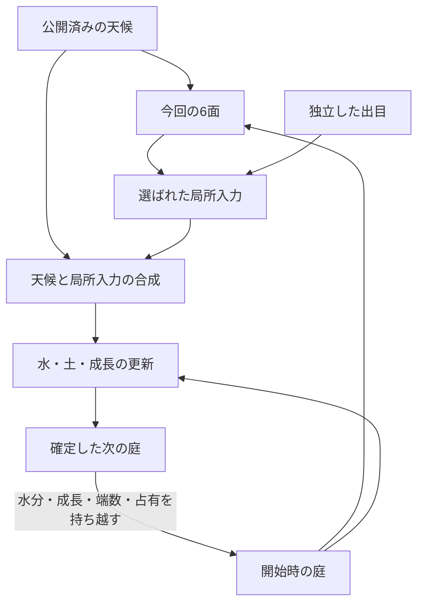

# 天候と庭の関係

文書版0.6 / 天候の数値・期の規則はv0.4を維持 / `designCandidate` / 2026-11-11。**Unity実装・実機での見た目と音は未検証。**

空の状態が庭全体の条件をつくり、その中へサイコロの水・風・光・種が加わる。以前に置いた種や、土に残る水があることで、同じ出目でも今回の意味が変わる。その重なりを眺め、気になった一投は記録から辿れる体験を目指す。

本書は天候と関係性の設計の入口。値と合成式は[weather-profile.v0.4.json](./content/weather-profile.v0.4.json)と[SIMULATION.md](./SIMULATION.md)、保存・中断は[DATA_CONTRACT.md](./DATA_CONTRACT.md)、配面と文章は[GAMEPLAY.md](./GAMEPLAY.md)、画面は[EXPERIENCE.md](./EXPERIENCE.md)を正とする。

v0.6では[DIVERSITY.md](./DIVERSITY.md)の三地点へ局所入力を届ける。同じ天候でも、選ばれた場所の土・岩・植物が違えば結果が変わる。場所変更は次の準備からで、天候期を進めたり天候を引き直したりしない。出生時の天候を使う花弁幅は表示だけの規則であり、天候の成長効果へ追加倍率を掛けない。

## 1. 三つの天候から始める

天候ごとに全域の光・風・雨を決め、既存の水の移動・吸水・蒸発・成長へ渡す。数値はゲーム内のモデル単位であり、照度や降水量の実測単位ではない。

| 天候 | 全域の光 | 全域の風 | 天候から入る水 | 体験で読み取る違い |
|---|---:|---:|---|---|
| 晴れ `clear` | 500 | 0 | なし | 水分がある場所では基礎光で育ち、光の入力も重ねられる |
| 薄曇り `cloudy` | 350 | 100、東向き | なし | 日差しが弱まり、岩陰と風が通る場所で乾き方が分かれる |
| 小雨 `drizzle` | 250 | 0 | 全非solidセルへ各1、offset 0,4,…,36 | 土と石地へ雨が入り、地形に沿って動き、空き容量に応じて土へ染みる |

現在の庭では雨の対象は253セル、10回の雨入力で2,530/投となる。雨は土だけを狙わず、水を通す石地にも入る。solidな岩のセルは対象にしない。雨の衝突・跳ね返りや風で雨粒が移動する新しい物理計算は、最小版へ追加しない。

既存の水レシピは最大1,200/投なので、この庭で小雨と重なる場合の合計入力は最大3,730/投。16×16という設定の検証上限は、非solidが最大256セルの場合を含め天候2,560、合計3,760とする。排出口の容量の合計だけで排水の十分さを判定せず、実地形の連続入力で照合する。

晴れの場は従来の基礎光500・無風に合わせる。この天候での自然算術をv0.3の参照結果と比較できる。天候を含む新しい配面規則・記録の版まで旧版と同じとする意味ではない。

## 2. 空は三投ずつ続き、振る前に分かる

天候の一期は**正常に解決・保存された3投**。開始時の`worldRevision`から`weatherPeriodIndex = floor(worldRevision / 3)`、期内の位置を`worldRevision % 3`で求める。

| 庭の開始revision | 天候期 | 決め方 |
|---|---:|---|
| 0, 1, 2 | 0 | 固定の晴れ |
| 3, 4, 5 | 1 | 晴れ96、薄曇り96、小雨64の重み付き抽選 |
| 6, 7, 8 | 2 | 同じ重みで独立した次の期を抽選 |
| 以降 | 同じ規則 | 同じ天候が続いてもそのまま採用 |

重みの合計は256。通常期の割合は晴れ37.5%、薄曇り37.5%、小雨25%で、短いrunでこの比率になる保証ではない。初期の晴れは開幕の設計条件として明記し、ランダムに晴れを引いたと表示しない。

各期の専用32byteを`WeatherEntropyCommitted`へ一度保存し、固定順`clear / cloudy / drizzle`で解釈する。初期期も重み`[256,0,0]`で同じ経路を使う。先頭のbig-endian uint32を`UniformBelow(256)`へ渡すため、4byteを消費し、棄却は起きない。出目・配面・カードのbufferは使わない。

保存済み天候を固定してから、保存mapping材料で今回の場所を解決し、その天候・場所・開始時の庭から6面を作る。画面の庭がその開始状態に対応し、Preparedの保存が済んだところで、現在の天候・場所・6面を一緒に公開する。その後で意図を編集・確定し、出目を取得する。

取消、出目欠測、配面準備の中断、履歴閲覧、祈っている時間、演出の省略では期を進めない。天候材料を保存した後に準備をやり直す場合も、同じ期の材料を使う。保存と回復の詳細はDATA_CONTRACTに集約する。

## 3. 庭・天候・出目のつながり

次の図は、モデルの計算に使う関係だけを示す。意図やカードが自然計算の入力になったという意味の矢印は含めない。

| 関係 | 実際にモデルが行うこと | 次の一投へ残るもの |
|---|---|---|
| 雨・ダイス水 → 地形 → 土 | 注水を合成し、水頭差で流し、空き容量まで吸水する | 地表水、土中水 |
| 天候の光・ダイス光 → 蒸発と成長 | 遮蔽後の光を両方の式へ渡す | 水分、成長量、各端数 |
| 天候の風・ダイス風 → 蒸発 → 湿り → 成長 | 岩の遮蔽を受けた風が蒸発を増やし、変わった湿りを成長条件へ渡す | 水分、成長量、各端数 |
| 種 → 場所の占有 → 次の種候補 | 選ばれた空き土へ個体を置き、そのセルを次回の空き候補から外す | 同じplantId、占有、成長段階 |
| 現在の庭・天候 → 次の6面 | 局所的な不足と、今回追加できる実効量から候補重みを求める | 保存済みの配面と、その生成根拠 |

風や光の場そのものを、前の投擲から強さとして積み上げない。前回の光の平均は観察記録として残し、今回の空の明るさへ再投入しない。現在の小さな植物モデルは、湿りと光へ応答し、場所を占有する。植物体の水消費、葉による新しい影、雲を生む蒸発循環は、今回の計算には含めない。

### 同じ入力を、異なる条件で読む

| 重なる条件 | 観察する関係 |
|---|---|
| 小雨 + ダイスの光 | 雨が入る場所に追加光が届き、合成された光と湿りで育つ |
| 小雨 + ダイスの風 | 雨が補給する水と、風による蒸発が同じ場所の水分へ作用する |
| 過湿な土 + 風 | 蒸発で適湿へ近づく可能性がある。実際に帯へ戻ったかを確認する |
| 乾いた土 + 同じ風 | 水分がさらに減り、成長が遅くなる場合がある |
| 以前に置いた種 + 今回の雨 | 同じ個体が雨のある回に発芽するかを追える |
| 植物で埋まる土 + 次の種入力 | 空き地が変わり、配置先・種候補・配面が変わる |

これらは必ず成功する組合せやコンボ報酬ではない。開始時の水分、遮蔽、入力の実効量、時点から結果を計算する。将来の雨を先に解決して「最善の出目」を選ぶ処理や、花を咲かせるための引き直しは入れない。

## 4. 混ざる前の入力と、混ざった後の変化

光と風は、天候の全域量とダイスの局所量を遮蔽前に合成し、上限1,000を適用してから、そのセルの露出・岩陰を掛ける。今回のダイスの実効分は「合成後 − 天候だけの場合」の差で残す。この差は同じセルの場の計算から直接求め、庭をもう一度シミュレーションする処理にはしない。

例えば薄曇りの風100へ、ダイスの強風1,000が中心で重なると、合成は1,000、追加の実効分は900。遮蔽250のセルなら、合成250・天候だけ25・追加225になる。天候分までサイコロが生んだ風として数えない。

| 保存対象 | 記録できること |
|---|---|
| 注入時の水 | 天候からの水、ダイスからの水、合計を分ける |
| 光・風の場 | 天候だけの値、合成値、ダイスの追加実効分を分ける |
| 土への吸水・蒸発・成長 | 合成された計算で、どのセル・個体に何が起きたかを残す |
| 過去の種と現在の植物 | 同じplantIdと出自によって、種→芽→葉→つぼみ→花の履歴を辿る |

水が混ざった後の吸水を、投入量の比率だけで雨由来／ダイス由来へ分けない。以前の雨が残した「同じ水」を追跡したことにもしない。「根元の土に染みた」は吸水の事実として記録できるが、植物体内へ取り込まれた量とは表示しない。

## 5. 意図・カード・言葉にも役割を持たせる

| 要素 | この体験での役割 |
|---|---|
| 天候 | 振る前に見える、庭全体の条件 |
| 動的な6面 | 今の庭と天候の中で、起こり得る局所入力 |
| 意図・祈り・言葉 | 結果を知る前に添えたものとして保存する |
| 出目 | 固定した6面から、今回加える一つを選ぶ |
| オラクルカード | 独立に引き、成立している出来事の中で見る角度を選ぶ |
| 短いメッセージ・FX・SE | 選ばれた同じ出来事と場所へ目を向ける |

カード6枚の確率は各1/6のまま。雨なら特定のカードを増やす、カードに合わせて天候を変える、といった連動はしない。天候の風しか届いていないセルを、ダイス風の直接入力groupへ採用しない。

天候との組合せを扱う短文は[oracle-catalog.v0.5.json](./content/oracle-catalog.v0.5.json)へ引き継ぐ。例えば「雨の中に、光が差しました。」は、同じ場所・重なる時間の実雨とダイス追加光が確認できた場合だけ使う。天候名が小雨であることだけでは成立しない。発芽の時点と雨のpulseが合わず、この文の条件を満たさない場合は、既存の事実文を選べる。

三投続く天候の中でも、同じカードに対応する別の事実が成立していれば、最近使っていない文へ目を向ける。本文28本と天候の成立条件はv0.4から変えず、選ぶ順序をGAMEPLAYのoracle-focus.v0.5へ揃える。同じ事実しかない回は、同じ言葉が続くこともある。

## 6. 神聖さと分かりやすさを保つ見せ方

### 空と、サイコロの作用を見分ける

現在の天候は小さな名前とアイコン、空全体の色調・環境音で示す。ダイスの選択面と作用点は、その上で局所的に強調する。天候の「小雨」と、面の入力名「小さな雨」を分け、履歴でも「天候」と「サイコロの入力」を別の行に置く。

待機中の雲・雨粒・草の揺れは、保存済み天候を示す穏やかなループにできる。土の水量・成長・期の進行は変えない。投擲で庭の時間が進み、その40tickに対応する自然の変化を見せる。天候を切り替える見た目の補間も、保存済みの次の条件を表すだけで、途中の光量をCoreへ戻さない。

### 音と光の強調を増やしすぎない

天候の音は環境音の一層へまとめる。ダイスの自然音を示す間は同じ層の音量・質感を調整し、雨のloopに風や水のloopを次々重ねない。既存の「主焦点1・補助1以下・鐘1・成長アクセント1以下」を保つ。天候が変わるたびに追加の祝福音や確認画面を出さない。

低刺激設定でも、天候名、選択面、作用範囲、植物の段階は残す。消音でも天候と一投の完了が分かるようにする。

### 既存の三つの見方へ収める

「庭の歩み」のround軸へ天候帯を足す。「一投のつながり」は開始時の庭・天候・ダイス入力の三つの入口から、同じ場所の変化を辿る。植物を選んだ詳細では、同じplantIdの段階履歴を小さく開ける。四つ目の常設グラフや、新しい報酬・収集操作は増やさない。

意図と出目の比較は、その回の保存済み6面に対応する基準確率を使う。後から選んだ雨の日だけの集計を、全体の一致率へ置き換えない。天候の帯は条件の違いを読み取るための記録であり、天候や祈りの効果の判定ラベルではない。

## 7. 照合と実装の順序

設計用の参照結果は[weather-reference-report.v0.4.json](./content/weather-reference-report.v0.4.json)へ分離する。旧[全庭参照v0.3](./content/garden-reference-report.v0.3.json)は、その当時の規則による比較資料として残す。新天候が入った通常プレイの結果へ読み替えない。

今回のPython参照計算は、三天候×8入力の24投、強制小雨＋最大注水の400投、固定seed16列×24投の384投、合計808投・32,320tick。全tickで水収支の残差0と状態範囲を確認し、晴れの8単発は旧v0.3の数値結果と一致した。Unityでの実行結果ではない。

同じ初期庭で「ひと筋の光」を一回加えたとき、中心のつぼみの成長量は開始1,700から、晴れ2,300・薄曇り2,210・小雨2,150になった。小雨も光を弱めるため、水が加わることだけで成長が有利になるとは限らない。同じ庭の`light_beam`候補重みは晴れ240・薄曇り258・小雨270で、暗い空では追加光の必要度が上がる。これは配面の候補重みであり、出目の確率を変更する値ではない。

連続200投の強制小雨では、どちらの水レシピも7投目から排水し、最終的に全庭の土中水は容量の54,200へ達した。数値範囲内であることと、長雨の見た目・遊び心地がよいことは分けて扱う。通常の16列では初開花2〜3投、24投後の花4〜13、整数成長が増えない投擲も13回あり、そのまま記録した。初開花は初期つぼみの寄与を含む。

G1は天候材料の保存・再利用と固定したWeatherContextを、一つの準備処理へ加える。G2は晴れで旧自然算術との一致を確認し、三天候と8入力、雨＋最大注水の連続入力を照合する。G3で空の見た目、自然文、作用点と同じ光・音、履歴の天候帯を接続する。

上記808投はv0.4の旧anchorによる記録である。現行三地点の長期注水は、入口・岩陰・ひらけた土×二つの水recipe×強制小雨を各200投の独立した開発runとして照合する。[v0.7の参照原本](./content/water-stress-reference-report.v0.7.json)と[GARDEN_LAYOUT](./GARDEN_LAYOUT.md)に別の結果を残し、旧入口の400投を新しい作用点の検証へ流用しない。C#と実機では同じ入力列から状態を再計算し、数値範囲だけでなく水面と植物が見分けられることも確認する。天候の係数・期・確率は変更しない。

天候API、現実の所在地・時刻、季節、気温、雪、雷、動的な雲の流体、植物の蒸散は追加機能の候補に留める。三つの天候が既存の庭としっかりつながることを、今回の最小単位にする。
